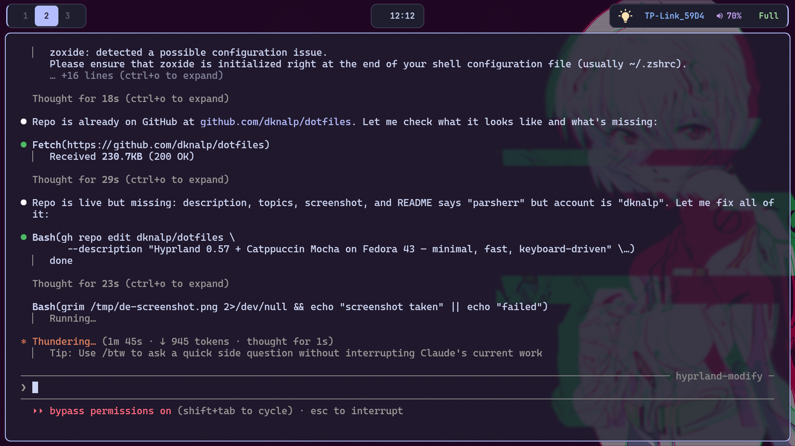

# dknalp/dotfiles

> Hyprland + Catppuccin Mocha on Fedora 43




---

## Stack

| Component | App |
|---|---|
| Window Manager | Hyprland 0.57 (Lua config) |
| Bar | Waybar — minimal Catppuccin Mocha |
| App Launcher | Rofi (Wayland) |
| Terminal | Kitty |
| Browser | Brave (Flatpak) |
| File Manager | Thunar |
| Screenshot | grim + slurp |
| Clipboard | cliphist + wl-clipboard |
| Wallpaper | swww |
| Night Light | hyprsunset |
| Notifications | swaync |
| Login Screen | SDDM (simple_sddm_2) |
| Color Theme | Catppuccin Mocha |
| Icons | Papirus-Dark |
| Font | JetBrains Mono Nerd Font |
| Color Generator | wallust (harddark16 + lchmixed) |

---

## Keybinds

| Key | Action |
|---|---|
| `Super + Enter` | Terminal (kitty) |
| `Super + Q` | Close window |
| `Super + D / Space` | App launcher (rofi) |
| `Super + W` | Brave browser |
| `Super + C` | VS Code |
| `Super + E` | File manager (Thunar) |
| `Super + F` | Wallpaper picker |
| `Super + V` | Clipboard history |
| `Super + .` | Keybind cheat sheet |
| `Super + 1-6` | Switch workspace |
| `Super + Shift + 1-6` | Move window to workspace |
| `Super + arrows` | Focus window |
| `Super + Shift + Up/Down` | Brightness ±5% |
| `Super + Shift + Left/Right` | Volume ±5% |
| `Print` | Screenshot (select area → clipboard) |

---

## Install

> **Requires:** Fedora 43 + Hyprland 0.57 already installed via [JaKooLit's Fedora-Hyprland](https://github.com/JaKooLit/Fedora-Hyprland)

**One-liner:**
```bash
bash <(curl -s https://raw.githubusercontent.com/dknalp/dotfiles/main/install.sh)
```

**Or clone and run:**
```bash
git clone https://github.com/dknalp/dotfiles.git ~/dotfiles
cd ~/dotfiles
./install.sh
```

The installer:
- Checks prerequisites (Hyprland, Waybar, Rofi, Kitty, swww, grim)
- Backs up existing `~/.config/{hypr,waybar,rofi,kitty,wallust}` to a timestamped folder
- Copies configs to correct locations
- Optionally installs the SDDM login screen theme
- Reloads Hyprland automatically if running

---

## Structure

```
dotfiles/
├── .config/
│   ├── hypr/          # hyprland.lua, UserConfigs, UserScripts, scripts
│   ├── waybar/        # config + minimal-catppuccin.css
│   ├── rofi/          # app launcher, wallpaper picker, cheatsheet themes
│   ├── kitty/         # terminal config
│   └── wallust/       # color generation config
├── sddm/              # login screen theme.conf
├── assets/            # screenshots
├── install.sh         # installer script
├── good-ideas.md      # notes from analyzing pro dotfiles repos
└── hyprland-setup-notes.md  # full setup journal (660+ lines)
```

---

## Credits

- [JaKooLit/Fedora-Hyprland](https://github.com/JaKooLit/Fedora-Hyprland) — base installer and dotfiles
- [end-4/dots-hyprland](https://github.com/end-4/dots-hyprland) — inspiration
- [Catppuccin](https://github.com/catppuccin/catppuccin) — color scheme
- [Hyprland](https://hyprland.org) — window manager

---

## License

MIT © dknalp
</content>
